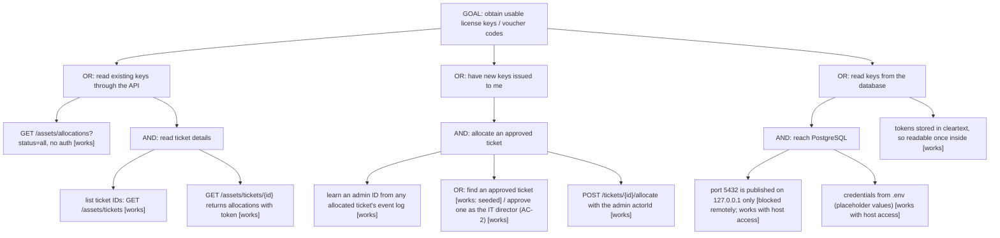
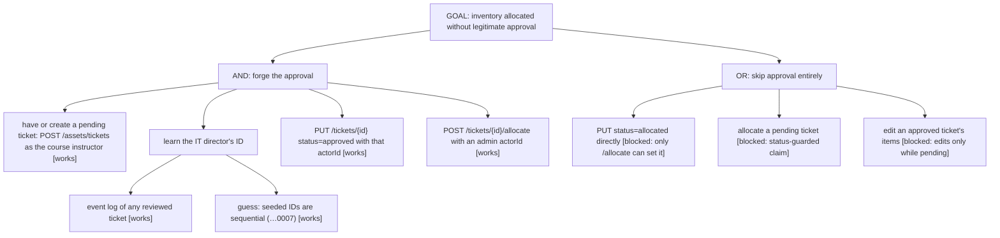
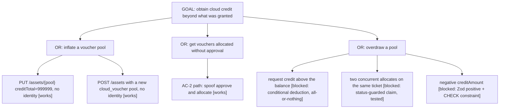
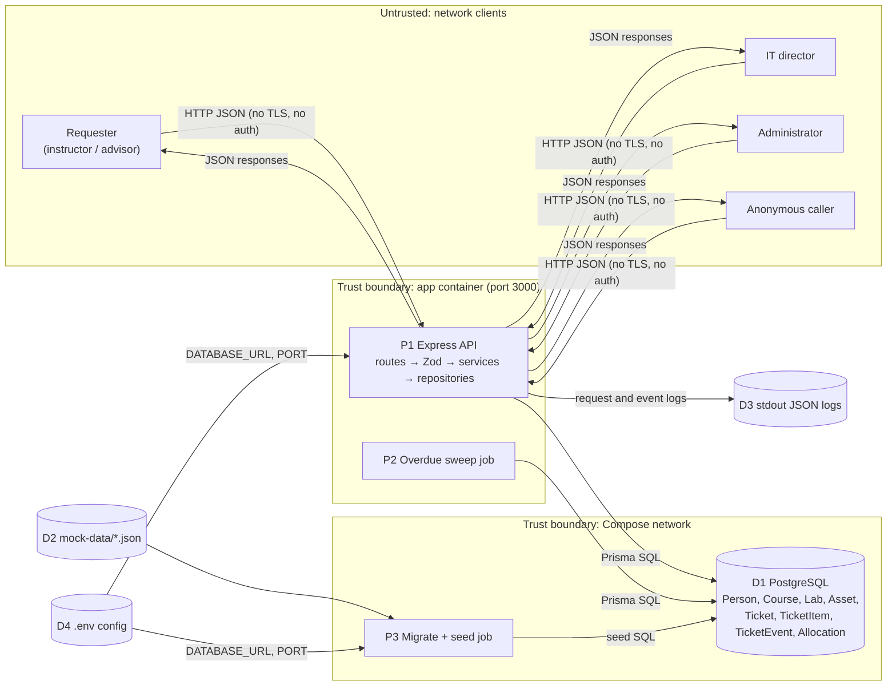

# Security Analysis: Resource Allocation & Help Desk Hub (PA2)

## AI Deliverable Metadata Block

| Field | Value |
|---|---|
| Deliverable | `security-analysis.md` (PA2) |
| Author | Amber Rastella |
| AI tools | Claude Code in the Claude desktop app (Claude Opus 5.5, `claude-opus-5-5`) |
| What the AI did | Wrote this document: security requirements, abuse cases, attack trees, attack surface map, DFD, STRIDE matrix and mitigations. It drew on its own code review of `functional-codebase/` and on the dynamic tests in `sast-triage-report.md` §4 |
| Human work | Directed the scope and sequence of the work, approved each step, and supplied the course requirements |
| Conceptual AI contribution | **~90%** (AI-generated analysis under the author's direction) |
| Summary of design-aid prompts | "Review the generated code"; "Update the project walkthrough and change what you need to help me finish"; "Please finish the things that are mine anyway so that way I can 100% submit this homework as complete" |
| AI log | Desktop review session: see `.ai_logs/conceptual_journal.md` §1.2 |

**System under analysis:** `functional-codebase/` on branch `pa2`, the naive baseline generated in
Prompt_test_log.md Entry 5. It is an Express 5 / Prisma 7 / PostgreSQL 17 service with 14 HTTP entry
points and no authentication. Confirmed vulnerabilities V1–V7 are in `sast-triage-report.md`.

**Domain assumptions for PA3** (the master spec doesn't name them; to confirm with the instructor):
the primary resource for row-level authorization is the **Ticket**, together with the Allocations
issued from it. The designated sensitive field is **`Allocation.token`** (license keys, voucher codes
and hardware assignment tokens).

---

## 1. Security requirements (defensive baseline)

| ID | Requirement | Category | Source |
|---|---|---|---|
| SR-1 | Every endpoint except `GET /health` requires a bearer JWT whose signature is verified with **RS256 or ES256** against the issuer's JWKS. An explicit algorithm allowlist rejects `none` and `HS256` (no algorithm confusion). | Authentication | PA3 min. 1; V1 |
| SR-2 | The `exp`, `iss` and `aud` claims are validated on every request (with `nbf` if present, and a small clock-skew allowance). Expired, wrong-issuer, wrong-audience and wrong-key tokens get 401. | Authentication | PA3 min. 2; V1 |
| SR-3 | The caller's identity and role come **only** from the verified token (`sub`, role claim, or a lookup by `sub`). `actorId` and `requesterId` are removed from every request body. | Authentication | V1 |
| SR-4 | Role-based access per endpoint follows the permission matrix below. Row-level authorization on Tickets and Allocations: an instructor or faculty advisor can read and act only on tickets and allocations of their own course or lab. Staff roles act within their duties. | Authorization | PA3 min. 3; V2 |
| SR-5 | `Allocation.token` is encrypted at the application layer (AES-256-GCM, a random nonce per value), with the key read from an environment variable that is never committed. Uniqueness checks use a keyed hash, not the plaintext. | Confidentiality | PA3 min. 4; V4 |
| SR-6 | API responses never include full tokens. List and detail views return a masked preview (e.g. the last 4 characters). The full value is returned only through a dedicated endpoint, to the owning group or staff, and every reveal is audited. | Confidentiality | V3 |
| SR-7 | Every write endpoint validates input against a strict schema (unknown fields rejected, types, ranges, lengths), and business limits are enforced server-side. Changes to `totalStock` and `creditTotal` are restricted to administrators. | Input / integrity | PA3 min. 5; V2 |
| SR-8 | Error responses are generic and never reveal person names, roles, whether an ID exists, or database metadata. Details go to server logs only. | Error handling | V5 |
| SR-9 | Every state change (tickets, allocations **and assets**) writes an append-only audit record whose actor is the token-verified identity. | Accountability | STRIDE T1 |
| SR-10 | Responses expose only the personal data a caller needs. Staff and requester emails and roles are not returned to callers outside the ticket's group or staff. | Privacy | STRIDE T3 |
| SR-11 | Request rate is limited per client, and read requests don't trigger database writes (the overdue sweep runs only on its schedule). | Availability | V7; STRIDE T2 |
| SR-12 | The container runs as a non-root user (`USER node`). The database port isn't published beyond the host, and its credentials come from the environment. | Deployment | V6 |

**Permission matrix (required by SR-4)**

| Endpoint | Instructor / faculty advisor | IT director | Admin |
|---|---|---|---|
| `GET /assets`, `GET /assets/{id}` | ✓ (catalog) | ✓ | ✓ |
| `POST/PUT/DELETE /assets...` | ✗ | ✗ | ✓ |
| `POST /assets/{id}/return` | ✗ | ✓ | ✓ |
| `GET /assets/allocations` | own course/lab only, tokens masked | ✓ masked | ✓ masked |
| `POST /assets/tickets` | ✓ for own course/lab | ✗ | ✗ |
| `GET /assets/tickets`, `GET /assets/tickets/{id}` | own course/lab only | ✓ | ✓ |
| `PUT /assets/tickets/{id}`: edit content | own pending ticket only | ✗ | ✗ |
| `PUT /assets/tickets/{id}`: approve or reject | ✗ | ✓ | ✗ |
| `PUT /assets/tickets/{id}`: close | own ticket | ✓ | ✓ |
| `DELETE /assets/tickets/{id}` | own pending ticket only | ✗ | ✓ |
| `POST /assets/tickets/{id}/allocate` | ✗ | ✗ | ✓ |

---

## 2. Abuse cases

| ID | Abuse case | Actor | Steps (against the current code) | Missing control | Impact | Evidence |
|---|---|---|---|---|---|---|
| AC-1 | **Harvest every license key and voucher code** | Anyone who can reach port 3000 | `GET /api/v1/assets/allocations?status=all&limit=200` | Authentication (SR-1), response filtering (SR-6) | Direct monetary loss: paid seats and cloud credit can be used or resold | Triage §4: 7 tokens, anonymous |
| AC-2 | **Get resources without IT-director sign-off** | Insider: an instructor | Submit a legitimate request for their own course, read the IT director's and an admin's IDs from any ticket's event log, then approve as the IT director and allocate as the admin | Identity from the token (SR-3); separation of duties (SR-4) | The approval workflow, the service's main business control, is bypassed, and the audit trail blames the wrong people | Triage §4: approve as `…0007`, allocate as `…0008` |
| AC-3 | **Mint cloud credit** | Anyone | `PUT /api/v1/assets/{voucherPool}` with `{"creditTotal": 999999}`, then request or allocate from the inflated pool | Authorization on asset writes (SR-4/SR-7) | Unlimited voucher credit appears in the books; financial records become meaningless | Triage §4: 25000 → 999999 |
| AC-4 | **Sabotage the help desk** | Anyone | `DELETE` pending tickets, `PUT` other people's pending tickets with different items, `DELETE` (retire) unused assets | Authorization (SR-4) | Lost requests, wrong allocations, lost trust in the system | Code review (V2) |
| AC-5 | **Staff reconnaissance for phishing** | Anyone | `GET /assets/tickets` and ticket details return names, emails and roles of requesters and staff. Error messages confirm which IDs exist | Data minimization (SR-10), generic errors (SR-8) | Targeted phishing of the IT director and admins, who are the accounts that approve and allocate | Triage §4: event-log `actor` objects; V5 messages |
| AC-6 | **Root inside the container after a code-execution bug** | Attacker who exploits any RCE | Use a vulnerable dependency or a future bug to run code as UID 0 | Non-root runtime (SR-12) | Full control of the container: files, the DB connection string, and a launch point for escape attempts | Triage §4: `id -u` = `0` |
| AC-7 | **Slow the service with cheap reads** | Anyone | Flood `GET /assets` or `GET /assets/allocations`. Each request opens a write transaction (overdue sweep), with no rate limit | Rate limiting, no writes on read (SR-11) | Database contention, and degraded or unavailable service | Code review (V7) |

---

## 3. Attack trees

Legend: **[works]** = verified against the current code (triage §4) or plain from the code.
**[blocked]** = a control in the current code stops it. OR = any child is enough. AND = all children are needed.

### 3.1 Attack tree for AC-1: steal license keys and voucher codes

**Cheapest path:** A1, a single anonymous request. Fixing it needs SR-1 *and* SR-6; with SR-5, a database leak also stops paying off.

### 3.2 Attack tree for AC-2: get resources without IT-director sign-off

**Takeaway:** the agent's lifecycle guards (B1–B3) hold. The workflow fails only because whoever
"approves" is identified by a value the caller supplies (A2 to A4). That is why SR-3 is the central fix.

### 3.3 Attack tree for AC-3: obtain more cloud credit than allocated

**Takeaway:** the arithmetic is safe (C1–C3 are blocked). Who may change the pool is not (A1, A2).

---

## 4. Attack surface map

Base path `/api/v1`, port 3000, plain HTTP. "Identity today" is what the current code checks.

| # | Method | Path | Writes? | Identity today | Sensitive data touched | Risk |
|---|---|---|---|---|---|---|
| 1 | GET | `/health` | No | None (intended) | None | Low |
| 2 | POST | `/assets` | Yes | **None** | Inventory, voucher credit totals | **High** (AC-3) |
| 3 | GET | `/assets` | Sweep (DB write) | None | Inventory levels | Low (AC-7) |
| 4 | GET | `/assets/{asset_id}` | Sweep | None | Inventory levels | Low |
| 5 | PUT | `/assets/{asset_id}` | Yes | **None** | Stock and `creditTotal` | **Critical** (AC-3, tested) |
| 6 | DELETE | `/assets/{asset_id}` | Yes (retire) | **None** | Asset availability | High (AC-4) |
| 7 | POST | `/assets/{asset_id}/return` | Yes | `actorId` in body, spoofable | Allocation status, stock | Medium |
| 8 | GET | `/assets/allocations` | Sweep | **None** | **License keys, voucher codes, hardware tokens** | **Critical** (AC-1, tested) |
| 9 | POST | `/assets/tickets` | Yes | `requesterId` in body, spoofable | Ticket contents | Medium |
| 10 | GET | `/assets/tickets` | No | None | Requester names, emails and roles | Medium (AC-5) |
| 11 | GET | `/assets/tickets/{ticket_id}` | Sweep | None | Staff identities in the event log; **issued keys** | **High** (AC-1, AC-5, tested) |
| 12 | PUT | `/assets/tickets/{ticket_id}` | Yes | `actorId`: role-checked for status changes, **optional for edits** | Ticket items, approval state | **Critical** (AC-2, tested) |
| 13 | DELETE | `/assets/tickets/{ticket_id}` | Yes | **None** | Pending tickets | High (AC-4) |
| 14 | POST | `/assets/tickets/{ticket_id}/allocate` | Yes (inventory and key issuance) | `actorId` in body, spoofable | Inventory, **key issuance** | **Critical** (AC-1, AC-2, tested) |
| 15 | n/a | PostgreSQL `127.0.0.1:5432` | Yes | DB password from `.env` (placeholder) | Everything, keys in cleartext | Medium (host access needed) |
| 16 | n/a | Overdue sweep job (every 5 min) | Yes | Internal | Allocation and asset status | Low |
| 17 | n/a | CI/CD pipeline (`devsecops.yml`) | Builds the image | GitHub permissions | Build integrity | Medium (supply chain; actions pinned to SHAs) |

**Highest-risk vectors:** #8 (key disclosure), #14 and #12 (spoofed allocate and approve), and #5
(credit minting). All four were exploited anonymously in testing.

---

## 5. STRIDE threat model

### 5.1 Data flow diagram

Trust boundaries: (1) network clients ↔ app container: every request crosses it, and today nothing
is checked there. (2) App container ↔ Compose network database. (3) Host ↔ database port 5432, bound
to localhost. (4) The CI pipeline that builds the image (outside this diagram, see the attack surface map, #17).

### 5.2 STRIDE matrix

| Component | Spoofing | Tampering | Repudiation | Information disclosure | Denial of service | Elevation of privilege |
|---|---|---|---|---|---|---|
| External entities | Any caller can claim any staff identity through `actorId` (V1, AC-2) | n/a (actors, not stores) | Callers can deny actions, since nothing ties a request to a verified person (T1) | n/a | n/a | n/a |
| P1 Express API | No authentication; identity taken from the request body (V1) | Unauthorized edits and deletes of tickets and assets (V2, AC-3/AC-4) | Asset changes write no audit record; ticket events record a spoofable actor (**T1**) | Keys in responses (V3); PII in ticket data (**T3**); revealing errors (V5) | No rate limit; reads trigger write transactions (**T2**, V7) | Anonymous caller acts as admin or IT director (V1+V2); process runs as root (V6) |
| P2 Overdue sweep | n/a (internal, no input) | Flags overdue by wall clock. Clock tampering needs host access | Status changes not audited per actor (system actor) | n/a | Also triggered by every GET, so runs repeatedly under load (T2) | n/a |
| P3 Migrate + seed | n/a | A tampered `mock-data` or migration in the repo changes production data (CI/review controls) | Runs unattended. Covered by git history | Seed contains real-looking staff emails (mock data) | Fails closed: the app waits for it | Runs with full DB rights (needed for DDL) |
| D1 PostgreSQL | Placeholder DB password; access limited to localhost | Anyone with DB access can change stock or balances directly | No DB-level audit of direct changes | **Keys stored in cleartext (V4)** | Table locks from the sweep under load (T2) | DB user owns the schema (no least privilege) |
| D2 Mock data | n/a | Edits change what is seeded | Covered by git history | Contains mock staff emails only | n/a | n/a |
| D3 Logs | Log lines carry no verified identity | Logs go to stdout and can be lost or rotated | Logs are the only trace of asset changes (T1) | Logs paths and IDs, not tokens or bodies (checked) | High-volume requests mean high-volume logs | n/a |
| D4 `.env` config | n/a | Changing `DATABASE_URL` redirects the app | n/a | Contains DB credentials (gitignored, placeholders) | Missing values make the app fail fast at startup | n/a |
| Flow: HTTP request/response | No authentication on the channel (V1) | No TLS: integrity in transit not protected (local deployment) | No request signing | Keys and PII in responses over plaintext HTTP (V3, T3) | No size or rate limits beyond the 100 kb body cap (T2) | n/a |
| Flow: P1 ↔ D1 | Fixed connection credentials | Parameterized queries only, so no SQL injection (triage §5) | n/a | Unencrypted connection inside the Compose network | Connection pool exhaustion under load (T2) | n/a |

### 5.3 The 3 STRIDE threats chosen for PA3 remediation

These add to the confirmed CWEs (V1–V6), which are already in PA3's scope.

| # | STRIDE threat | Component | One-line risk rationale |
|---|---|---|---|
| T1 | **Repudiation:** asset changes (create, resize, credit change, retire) leave no audit record, and ticket events record a spoofable `actorId` | P1 / D1 | After the credit-minting test (AC-3), nothing in the database shows who changed the pool, so fraud can't be attributed or reversed with confidence. |
| T2 | **Denial of service:** no rate limiting, and every read runs a write transaction (overdue sweep) | P1 / D1 | One unauthenticated client looping cheap GETs creates write contention on the same rows the allocation engine locks. |
| T3 | **Information disclosure (PII):** ticket list and detail responses expose names, emails and roles of requesters and staff to any caller | P1 / HTTP flow | It hands attackers a ready target list of the exact accounts (IT director, admins) that hold approval and allocation power (AC-5). |

---

## 6. Proposed mitigations

| Finding / threat | Mitigation | Requirement |
|---|---|---|
| V1 Missing authentication / spoofable `actorId` (CWE-306, CWE-290) | Add JWT middleware (RS256 or ES256, JWKS from the course mock issuer, `algorithms` allowlist, `iss`, `aud` and `exp` checks) to every route except `/health`. Put the verified identity on `req.user`, and delete `actorId` and `requesterId` from all schemas and services. `requireActor` takes the role from `req.user`. | SR-1, SR-2, SR-3 |
| V2 Missing authorization (CWE-862) | Per-route role middleware following the permission matrix. Row-level filters in the repositories: tickets and allocations scoped to the caller's course or lab unless the caller is staff, and ownership checks on edits and deletes. | SR-4, SR-7 |
| V3 Keys in API responses (CWE-200) | Replace the spread in `serializeAllocation` with an explicit allow-list of fields and a masked `tokenPreview`. Add a separate reveal endpoint, owner or staff only, that writes an audit event. | SR-6 |
| V4 Keys stored in cleartext (CWE-312) | Encrypt `Allocation.token` with AES-256-GCM (`node:crypto`), using a key from `TOKEN_ENCRYPTION_KEY` (32 bytes, base64) in the environment, never committed. Store the ciphertext, nonce and tag, plus an HMAC for uniqueness. Fail at startup if the key is missing. | SR-5 |
| V5 Revealing error messages (CWE-209) | Generic 401/403/404 bodies. Log the detail server-side only. Stop returning Prisma `err.meta`. | SR-8 |
| V6 Container runs as root (CWE-250) | In the runtime stage, `COPY --chown=node:node …` and `USER node`. Verify with `docker compose exec app id -u` (expect `1000`). | SR-12 |
| V7 / T2 Resource exhaustion | `express-rate-limit` (per IP and per token). Remove `sweepOverdue()` from GET handlers, so only the scheduled job runs it. | SR-11 |
| T1 Repudiation | Generalize `TicketEvent` into an append-only audit table that also covers asset create, update and retire, and token reveals, with the actor taken from the verified token. No API to update or delete audit rows. | SR-9 |
| T3 PII disclosure | Return only `id` and display name for people. Show email and role to staff only, and only in ticket detail. Apply the row-level filters from V2. | SR-10 |
