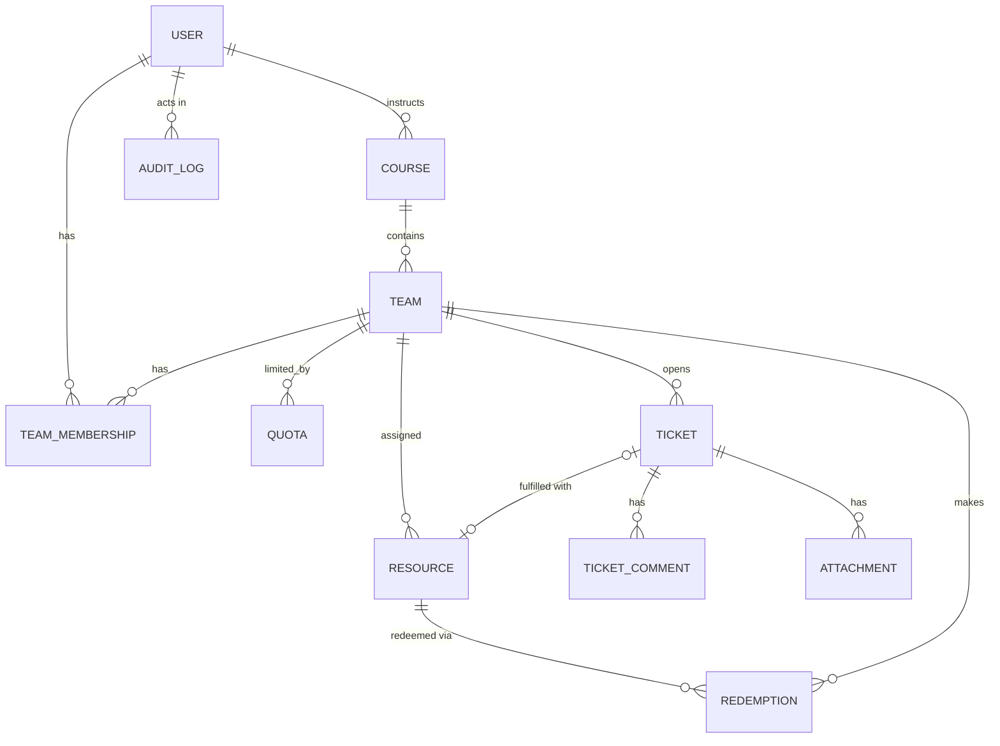

# Resource Allocation & Help Desk Hub — Service Specification

**Project Portal (PP) — Domain 2**
CS763 Secure Software Development · Project Assignment 1
Author: Amber Rastella · Version 1.0 · 2026-10-28

---

## 1. Purpose and Scope

The Resource Allocation & Help Desk Hub (RAHD) manages the distribution of critical project assets to student project teams across course groups in the Project Portal. It covers:

- **Resource inventory.** Software license keys and cloud credit vouchers, with tracking parameters such as cost center and funding source.
- **Allocation.** Assigning resources to teams, revoking them, and redeeming voucher credit.
- **Expiration.** Resources carry an expiry date and are automatically revoked when it passes.
- **Usage quotas.** Per-team limits on the number of license keys and total cloud credit per term.
- **Help desk.** Teams open tickets either to request resources (subject to instructor approval) or to report support issues, with comments and file attachments.
- **Audit trail.** An append-only log of every allocation, approval, redemption, revocation and ticket state change.

### 1.1 Out of Scope

- Identity management. The central PP identity provider is external, and this service is given a caller identity (see §4).
- Communication with any other PP service. Course and team rosters come from local static mock data (§9).
- Real third-party license or cloud-provider APIs. Keys and vouchers are opaque strings stored by this service.
- Email, webhook or push notifications.

### 1.2 Technology Stack

| Layer | Choice |
|---|---|
| Runtime | Node.js 24 LTS |
| Language | TypeScript (strict mode) |
| Web framework | Express 5 |
| Database | PostgreSQL 17 |
| ORM / migrations | Prisma |
| Request validation | Zod |
| File storage | Local Docker volume (`/data/attachments`) |
| Scheduler | In-process job runner (`node-cron`) |
| Testing | Vitest + Supertest |
| Packaging | Multi-stage Docker image, Docker Compose (app + db) |

---

## 2. Actors and Roles

| Role | Description |
|---|---|
| `ADMIN` | Help desk / resource staff. Manages the inventory, quotas and all tickets. |
| `INSTRUCTOR` | Owns one or more courses. Approves or rejects resource requests from teams in their courses and views their teams' usage. |
| `STUDENT` | Member of one or more teams. A team can have one designated **team lead**. |

---

## 3. Data Model

### 3.1 Entity–Relationship Diagram



### 3.2 Entities

All IDs are UUIDv4. All timestamps are ISO-8601 UTC. All money is stored as **integer cents**.

**User**

| Field | Type | Notes |
|---|---|---|
| id | uuid | PK |
| email | string | unique |
| displayName | string | |
| role | enum `ADMIN \| INSTRUCTOR \| STUDENT` | |
| createdAt | timestamp | |

**Course**

| Field | Type | Notes |
|---|---|---|
| id | uuid | PK |
| code | string | e.g. `CS763` |
| name | string | |
| term | string | e.g. `2026-FALL` |
| instructorId | uuid | FK → User (role `INSTRUCTOR`) |

**Team**

| Field | Type | Notes |
|---|---|---|
| id | uuid | PK |
| courseId | uuid | FK → Course |
| name | string | unique within course |

**TeamMembership**

| Field | Type | Notes |
|---|---|---|
| teamId | uuid | PK (composite), FK → Team |
| userId | uuid | PK (composite), FK → User |
| isLead | boolean | at most one lead per team |

**Resource**

| Field | Type | Notes |
|---|---|---|
| id | uuid | PK |
| type | enum `LICENSE_KEY \| CLOUD_VOUCHER` | |
| name | string | e.g. "JetBrains All Products" |
| provider | string | e.g. "JetBrains", "AWS" |
| secretValue | string | license key or voucher code |
| creditAmountCents | integer, nullable | voucher face value (vouchers only) |
| creditBalanceCents | integer, nullable | remaining balance (vouchers only) |
| trackingParams | jsonb | e.g. `{ "costCenter": "MET-CS", "fundingSource": "dept-grant-26" }` |
| status | enum `AVAILABLE \| ASSIGNED \| EXPIRED \| REVOKED` | |
| assignedTeamId | uuid, nullable | FK → Team |
| assignedAt | timestamp, nullable | |
| expiresAt | timestamp, nullable | null = never expires |
| revokedReason | string, nullable | |
| createdBy | uuid | FK → User |
| createdAt / updatedAt | timestamp | |

**Redemption** (voucher spend events)

| Field | Type | Notes |
|---|---|---|
| id | uuid | PK |
| resourceId | uuid | FK → Resource (type `CLOUD_VOUCHER`) |
| teamId | uuid | FK → Team |
| userId | uuid | FK → User who redeemed |
| amountCents | integer | > 0 |
| note | string | free text, e.g. "EC2 for load test" |
| createdAt | timestamp | |

**Quota**

| Field | Type | Notes |
|---|---|---|
| id | uuid | PK |
| teamId | uuid | FK → Team |
| term | string | matches Course.term |
| resourceType | enum `LICENSE_KEY \| CLOUD_VOUCHER` | unique with (teamId, term) |
| maxCount | integer, nullable | max concurrently assigned license keys |
| maxCreditCents | integer, nullable | max total voucher credit assigned in the term |

**Ticket**

| Field | Type | Notes |
|---|---|---|
| id | uuid | PK |
| category | enum `RESOURCE_REQUEST \| SUPPORT_ISSUE` | |
| teamId | uuid | FK → Team |
| createdBy | uuid | FK → User |
| title | string | max 200 chars |
| description | string | max 10,000 chars |
| requestedResourceType | enum, nullable | required for `RESOURCE_REQUEST` |
| requestedCreditCents | integer, nullable | required when requesting a voucher |
| status | enum `OPEN \| IN_REVIEW \| APPROVED \| REJECTED \| FULFILLED \| CLOSED` | |
| assigneeId | uuid, nullable | FK → User (ADMIN) |
| decisionBy | uuid, nullable | instructor who approved/rejected |
| decisionNote | string, nullable | |
| fulfilledResourceId | uuid, nullable | FK → Resource |
| createdAt / updatedAt | timestamp | |

**TicketComment**

| Field | Type | Notes |
|---|---|---|
| id | uuid | PK |
| ticketId | uuid | FK → Ticket |
| authorId | uuid | FK → User |
| body | string | max 5,000 chars |
| createdAt | timestamp | |

**Attachment**

| Field | Type | Notes |
|---|---|---|
| id | uuid | PK |
| ticketId | uuid | FK → Ticket |
| uploadedBy | uuid | FK → User |
| originalFilename | string | as supplied by the client |
| storedFilename | string | server-generated name on the volume |
| mimeType | string | |
| sizeBytes | integer | |
| sha256 | string | content hash |
| createdAt | timestamp | |

**AuditLog** (append-only, no update or delete)

| Field | Type | Notes |
|---|---|---|
| id | uuid | PK |
| actorId | uuid, nullable | null for system jobs |
| action | string | e.g. `RESOURCE_ASSIGNED`, `VOUCHER_REDEEMED`, `TICKET_APPROVED`, `RESOURCE_EXPIRED` |
| entityType | string | `Resource`, `Ticket`, `Quota`, … |
| entityId | uuid | |
| details | jsonb | before/after values relevant to the action |
| createdAt | timestamp | |

---

## 4. Caller Identity

Identity issuance belongs to the external PP identity service, which is out of scope. Every request except `/health` carries `Authorization: Bearer <token>`. The token identifies the caller's `userId`; role and team memberships are looked up from this service's database.

For local development and testing, a **dev-only** endpoint `POST /api/v1/auth/mock-login` issues a token for any seeded mock user. It must be disabled when `NODE_ENV=production`.

---

## 5. API Specification

Base path: `/api/v1`. All bodies are JSON unless noted. List endpoints support `?page=` (default 1) and `?pageSize=` (default 20, max 100).

### 5.1 Endpoint Summary

| # | Method | Path | Who | Purpose |
|---|---|---|---|---|
| 1 | GET | `/health` | public | Liveness check |
| 2 | POST | `/auth/mock-login` | dev only | Issue a token for a mock user |
| 3 | GET | `/me` | any | Current user, role, teams |
| 4 | GET | `/teams` | any | Teams visible to caller |
| 5 | GET | `/teams/{teamId}/usage` | team member, course instructor, admin | Current usage vs. quota |
| 6 | GET | `/teams/{teamId}/quotas` | team member, course instructor, admin | List quotas |
| 7 | PUT | `/teams/{teamId}/quotas/{resourceType}` | admin | Create/replace a quota |
| 8 | GET | `/resources` | any (scoped) | List resources (secrets masked) |
| 9 | POST | `/resources` | admin | Add a resource to inventory |
| 10 | GET | `/resources/{id}` | scoped | Resource detail (secret masked) |
| 11 | PATCH | `/resources/{id}` | admin | Edit name, tracking params, expiry |
| 12 | GET | `/resources/{id}/secret` | assigned team member, admin | Reveal full key/voucher code |
| 13 | POST | `/resources/{id}/assign` | admin | Assign to a team (quota-checked) |
| 14 | POST | `/resources/{id}/revoke` | admin | Revoke with reason |
| 15 | POST | `/resources/{id}/redemptions` | assigned team member | Spend voucher credit |
| 16 | GET | `/resources/{id}/redemptions` | assigned team member, instructor, admin | Redemption history |
| 17 | GET | `/tickets` | any (scoped) | List tickets |
| 18 | POST | `/tickets` | student (own team), admin | Open a ticket |
| 19 | GET | `/tickets/{id}` | scoped | Ticket detail with comments and attachment list |
| 20 | PATCH | `/tickets/{id}` | creator (while `OPEN`), admin | Edit title/description, assign staff |
| 21 | POST | `/tickets/{id}/decision` | course instructor | Approve or reject a resource request |
| 22 | POST | `/tickets/{id}/fulfill` | admin | Link an assigned resource and mark fulfilled |
| 23 | POST | `/tickets/{id}/close` | creator, admin | Close the ticket |
| 24 | POST | `/tickets/{id}/comments` | scoped | Add a comment |
| 25 | POST | `/tickets/{id}/attachments` | scoped | Upload a file (multipart) |
| 26 | GET | `/tickets/{id}/attachments/{attachmentId}` | scoped | Download a file |
| 27 | DELETE | `/tickets/{id}/attachments/{attachmentId}` | uploader, admin | Remove a file |
| 28 | GET | `/audit-logs` | admin; instructor (own courses) | Query the audit trail |
| 29 | POST | `/admin/jobs/expire-resources` | admin | Manually trigger the expiration job |

"Scoped" means students see only their own teams' records, instructors see records for teams in courses they teach, and admins see everything (§6).

### 5.2 Request and Response Schemas

**Error format (all endpoints)**

```json
{
  "error": {
    "code": "QUOTA_EXCEEDED",
    "message": "Team has reached its LICENSE_KEY quota for 2026-FALL.",
    "details": { "maxCount": 3, "current": 3 }
  }
}
```

Standard codes: `VALIDATION_ERROR` (400), `UNAUTHENTICATED` (401), `FORBIDDEN` (403), `NOT_FOUND` (404), `CONFLICT` (409), `QUOTA_EXCEEDED` (409), `INSUFFICIENT_BALANCE` (409), `PAYLOAD_TOO_LARGE` (413), `UNSUPPORTED_MEDIA_TYPE` (415).

**POST `/auth/mock-login`**

```json
// request
{ "email": "jlee@bu.edu" }
// 200
{ "token": "<opaque-or-jwt>", "user": { "id": "…", "role": "STUDENT" } }
```

**GET `/me`** → 200

```json
{
  "id": "b1e2…",
  "email": "jlee@bu.edu",
  "displayName": "Jordan Lee",
  "role": "STUDENT",
  "teams": [{ "id": "t-01…", "name": "Team Falcon", "courseCode": "CS763", "isLead": true }]
}
```

**GET `/teams/{teamId}/usage`** → 200

```json
{
  "teamId": "t-01…",
  "term": "2026-FALL",
  "licenseKeys": { "assigned": 2, "maxCount": 3 },
  "cloudCredit": { "assignedCents": 15000, "redeemedCents": 4200, "maxCreditCents": 25000 }
}
```

**PUT `/teams/{teamId}/quotas/{resourceType}`**

```json
// request
{ "term": "2026-FALL", "maxCount": 3, "maxCreditCents": null }
// 200 → Quota object
```

**Resource object (list and detail views)**

```json
{
  "id": "r-9f…",
  "type": "CLOUD_VOUCHER",
  "name": "AWS Educate Credit",
  "provider": "AWS",
  "secretPreview": "AWS-****-****-7Q2X",
  "creditAmountCents": 10000,
  "creditBalanceCents": 5800,
  "trackingParams": { "costCenter": "MET-CS", "fundingSource": "dept-grant-26" },
  "status": "ASSIGNED",
  "assignedTeamId": "t-01…",
  "assignedAt": "2026-11-02T14:00:00Z",
  "expiresAt": "2026-12-20T23:59:59Z",
  "createdAt": "2026-10-30T09:00:00Z"
}
```

**POST `/resources`**

```json
// request
{
  "type": "LICENSE_KEY",
  "name": "JetBrains All Products",
  "provider": "JetBrains",
  "secretValue": "JB-7H2K-99QX-LM4P",
  "trackingParams": { "costCenter": "MET-CS" },
  "expiresAt": "2027-05-31T23:59:59Z"
}
// For CLOUD_VOUCHER, "creditAmountCents" is required.
// 201 → Resource object
```

**GET `/resources/{id}/secret`** → 200 `{ "id": "r-9f…", "secretValue": "AWS-8KD2-PP01-7Q2X" }`. Each call writes a `SECRET_VIEWED` audit entry.

**POST `/resources/{id}/assign`**

```json
// request
{ "teamId": "t-01…", "ticketId": "k-55…" }   // ticketId optional
// 200 → Resource object (status ASSIGNED)
// 409 QUOTA_EXCEEDED | CONFLICT (not AVAILABLE)
```

**POST `/resources/{id}/revoke`** → request `{ "reason": "Team dissolved" }` → 200 Resource (status `REVOKED`).

**POST `/resources/{id}/redemptions`**

```json
// request
{ "amountCents": 1200, "note": "EC2 t3.medium for load testing" }
// 201
{ "id": "rd-3a…", "resourceId": "r-9f…", "amountCents": 1200, "balanceAfterCents": 4600, "createdAt": "…" }
// 409 INSUFFICIENT_BALANCE | CONFLICT (expired/revoked)
```

**POST `/tickets`**

```json
// RESOURCE_REQUEST
{
  "category": "RESOURCE_REQUEST",
  "teamId": "t-01…",
  "title": "Need AWS credit for capstone load testing",
  "description": "We need about $50 of EC2 time for week 10.",
  "requestedResourceType": "CLOUD_VOUCHER",
  "requestedCreditCents": 5000
}
// SUPPORT_ISSUE
{
  "category": "SUPPORT_ISSUE",
  "teamId": "t-01…",
  "title": "License key rejected by IDE",
  "description": "The key assigned on 11/2 says 'invalid'."
}
// 201 → Ticket object
```

**Ticket object**

```json
{
  "id": "k-55…",
  "category": "RESOURCE_REQUEST",
  "teamId": "t-01…",
  "createdBy": "b1e2…",
  "title": "Need AWS credit for capstone load testing",
  "description": "…",
  "requestedResourceType": "CLOUD_VOUCHER",
  "requestedCreditCents": 5000,
  "status": "OPEN",
  "assigneeId": null,
  "decisionBy": null,
  "decisionNote": null,
  "fulfilledResourceId": null,
  "comments": [{ "id": "c-1…", "authorId": "…", "body": "…", "createdAt": "…" }],
  "attachments": [{ "id": "a-7…", "originalFilename": "error.png", "mimeType": "image/png", "sizeBytes": 48211, "createdAt": "…" }],
  "createdAt": "…",
  "updatedAt": "…"
}
```

**POST `/tickets/{id}/decision`** → request `{ "decision": "APPROVED", "note": "Approved for week 10" }` → 200 Ticket.

**POST `/tickets/{id}/fulfill`** → request `{ "resourceId": "r-9f…" }` → 200 Ticket (status `FULFILLED`). The resource must already be assigned to the ticket's team.

**POST `/tickets/{id}/comments`** → request `{ "body": "…" }` → 201 Comment.

**POST `/tickets/{id}/attachments`**: `multipart/form-data` with one field `file`. Returns 201 Attachment metadata.

**GET `/tickets/{id}/attachments/{attachmentId}`**: returns the file bytes with `Content-Type` from metadata and `Content-Disposition: attachment; filename="<originalFilename>"`.

**GET `/audit-logs`**: filters `?entityType=`, `?entityId=`, `?actorId=`, `?action=`, `?from=`, `?to=`. Returns a paginated list of AuditLog objects.

---

## 6. Business Rules

### 6.1 Access Scope

| Data | STUDENT | INSTRUCTOR | ADMIN |
|---|---|---|---|
| Teams | own teams | teams in own courses | all |
| Resources | assigned to own teams | assigned to teams in own courses | all, including `AVAILABLE` inventory |
| Full secret value | own team's assigned resources | — | all |
| Tickets | own teams' tickets | own courses' tickets | all |
| Quotas & usage | own teams (read) | own courses (read) | all (read/write) |
| Audit log | — | entries for own courses | all |

### 6.2 Resources

1. A resource can only be assigned when its status is `AVAILABLE`.
2. Revoking sets status to `REVOKED`, keeps `assignedTeamId` for history, and requires a reason.
3. `EXPIRED` and `REVOKED` are terminal. Their secrets can no longer be revealed to students, and vouchers cannot be redeemed.
4. List and detail views show only `secretPreview` (the provider prefix plus last 4 characters). The full value is returned only by `GET /resources/{id}/secret`.

### 6.3 Expiration and Automatic Revocation

1. A scheduled job runs every 15 minutes, plus on demand via endpoint 29.
2. Any resource with `expiresAt <= now` and status `AVAILABLE` or `ASSIGNED` becomes `EXPIRED`.
3. Each expiration writes a `RESOURCE_EXPIRED` audit entry with `actorId = null`.
4. Resources expiring within 7 days are flagged `expiringSoon: true` in API responses.

### 6.4 Usage Quotas

1. Quotas apply per team, per term, per resource type. With no quota row, the default is no limit.
2. **License keys:** assignment fails with `QUOTA_EXCEEDED` if the team's count of `ASSIGNED` license keys would exceed `maxCount`.
3. **Cloud vouchers:** assignment fails if the sum of `creditAmountCents` across vouchers assigned to the team this term would exceed `maxCreditCents`.
4. Instructor approval of a resource request also checks the quota and rejects approvals that would exceed it.
5. Lowering a quota below current usage is allowed. It blocks new assignments but does not revoke existing ones.

### 6.5 Voucher Redemption

1. Only members of the assigned team can redeem, and only while the voucher is `ASSIGNED`.
2. `amountCents` must be a positive integer no greater than `creditBalanceCents`.
3. The balance decrement and redemption insert happen in one transaction, so concurrent redemptions can never take the balance below zero.

### 6.6 Ticket Workflow

```
OPEN ──► IN_REVIEW ──► APPROVED ──► FULFILLED ──► CLOSED
  │          │      └► REJECTED ─────────────────► CLOSED
  └──────────┴─────────────────────────────────────► CLOSED   (SUPPORT_ISSUE path)
```

1. `RESOURCE_REQUEST` tickets must be approved by the **instructor of the team's course** before an admin can fulfill them. A user can never approve a ticket they created.
2. `SUPPORT_ISSUE` tickets skip the decision step and go from `OPEN` or `IN_REVIEW` straight to `CLOSED`.
3. The creator can edit title and description only while the ticket is `OPEN`.
4. Comments and attachments are allowed until the ticket is `CLOSED`.

### 6.7 Attachments

1. Max file size is 5 MB, with at most 5 attachments per ticket.
2. Allowed types: `image/png`, `image/jpeg`, `application/pdf`, `text/plain`. The type is determined from file content, not just the extension or client header.
3. Files are stored under `/data/attachments/` with a server-generated UUID filename. `originalFilename` is metadata only and never used as a filesystem path.
4. Downloads are always served with `Content-Disposition: attachment`.

### 6.8 Audit Logging

Every state-changing operation writes an AuditLog row in the same transaction as the change. This includes resource create, edit, assign, revoke, expire and secret reveal; redemptions; quota changes; and ticket create, edit, decision, fulfill, close, comment and attachment upload or delete. Audit rows are never updated or deleted through the API.

---

## 7. Non-Functional Requirements

| ID | Requirement |
|---|---|
| NFR-1 | Containerized: `docker compose up` starts the app and PostgreSQL with seeded mock data. |
| NFR-2 | Configuration comes from environment variables only. No secrets are committed to the repository. |
| NFR-3 | p95 latency under 300 ms for non-upload endpoints with seeded data. |
| NFR-4 | Health endpoint responds within 1 second for container orchestration. |
| NFR-5 | Structured JSON logs to stdout, with a correlation ID per request. |
| NFR-6 | Database schema managed by versioned Prisma migrations. |
| NFR-7 | Integration test suite covers every endpoint's happy path. |

---

## 8. Security-Relevant Assets (input to later threat modeling)

| Asset | Why it matters |
|---|---|
| License keys and voucher codes | Direct monetary value. Leakage across teams or to outsiders is a confidentiality breach. |
| Voucher balances | Integrity. Unauthorized or duplicated redemptions cost the department money. |
| Quotas and approvals | Integrity and authorization. Bypassing them lets a team take more than its allocation. |
| Ticket content and attachments | User-supplied content and files, shown to staff and instructors. |
| Audit log | Non-repudiation. Tampering would hide misuse. |

---

## 9. Static Mock Data

Seed files live in `/mock-data/` and are loaded by `npm run seed`, which also runs on first container start. They replace any dependency on other PP services.

```
mock-data/
├── users.json
├── courses.json
├── teams.json
├── memberships.json
├── resources.json
├── quotas.json
├── tickets.json
└── attachments/        # sample.pdf, screenshot.png
```

**users.json**

```json
[
  { "id": "00000000-0000-4000-8000-000000000001", "email": "helpdesk@bu.edu",  "displayName": "Pat Morgan",  "role": "ADMIN" },
  { "id": "00000000-0000-4000-8000-000000000002", "email": "prof.kim@bu.edu",  "displayName": "Dr. Ana Kim", "role": "INSTRUCTOR" },
  { "id": "00000000-0000-4000-8000-000000000003", "email": "prof.ruiz@bu.edu", "displayName": "Dr. Leo Ruiz","role": "INSTRUCTOR" },
  { "id": "00000000-0000-4000-8000-000000000011", "email": "jlee@bu.edu",      "displayName": "Jordan Lee",  "role": "STUDENT" },
  { "id": "00000000-0000-4000-8000-000000000012", "email": "spatel@bu.edu",    "displayName": "Sam Patel",   "role": "STUDENT" },
  { "id": "00000000-0000-4000-8000-000000000013", "email": "mchen@bu.edu",     "displayName": "Mia Chen",    "role": "STUDENT" },
  { "id": "00000000-0000-4000-8000-000000000014", "email": "ogarcia@bu.edu",   "displayName": "Omar Garcia", "role": "STUDENT" }
]
```

**courses.json**

```json
[
  { "id": "10000000-0000-4000-8000-000000000001", "code": "CS763", "name": "Secure Software Development", "term": "2026-FALL", "instructorId": "00000000-0000-4000-8000-000000000002" },
  { "id": "10000000-0000-4000-8000-000000000002", "code": "CS673", "name": "Software Engineering",        "term": "2026-FALL", "instructorId": "00000000-0000-4000-8000-000000000003" }
]
```

**teams.json** and **memberships.json**

```json
[
  { "id": "20000000-0000-4000-8000-000000000001", "courseId": "10000000-0000-4000-8000-000000000001", "name": "Team Falcon" },
  { "id": "20000000-0000-4000-8000-000000000002", "courseId": "10000000-0000-4000-8000-000000000001", "name": "Team Orca" },
  { "id": "20000000-0000-4000-8000-000000000003", "courseId": "10000000-0000-4000-8000-000000000002", "name": "Team Juniper" }
]
```

```json
[
  { "teamId": "20000000-0000-4000-8000-000000000001", "userId": "00000000-0000-4000-8000-000000000011", "isLead": true },
  { "teamId": "20000000-0000-4000-8000-000000000001", "userId": "00000000-0000-4000-8000-000000000012", "isLead": false },
  { "teamId": "20000000-0000-4000-8000-000000000002", "userId": "00000000-0000-4000-8000-000000000013", "isLead": true },
  { "teamId": "20000000-0000-4000-8000-000000000003", "userId": "00000000-0000-4000-8000-000000000014", "isLead": true }
]
```

**resources.json** (fake values only)

```json
[
  { "id": "30000000-0000-4000-8000-000000000001", "type": "LICENSE_KEY",   "name": "JetBrains All Products", "provider": "JetBrains", "secretValue": "JB-FAKE-7H2K-99QX", "status": "ASSIGNED",  "assignedTeamId": "20000000-0000-4000-8000-000000000001", "expiresAt": "2027-05-31T23:59:59Z", "trackingParams": { "costCenter": "MET-CS" } },
  { "id": "30000000-0000-4000-8000-000000000002", "type": "LICENSE_KEY",   "name": "JetBrains All Products", "provider": "JetBrains", "secretValue": "JB-FAKE-LM4P-22AB", "status": "AVAILABLE", "assignedTeamId": null, "expiresAt": "2027-05-31T23:59:59Z", "trackingParams": { "costCenter": "MET-CS" } },
  { "id": "30000000-0000-4000-8000-000000000003", "type": "CLOUD_VOUCHER", "name": "AWS Educate Credit",     "provider": "AWS",       "secretValue": "AWS-FAKE-8KD2-7Q2X", "creditAmountCents": 10000, "creditBalanceCents": 5800, "status": "ASSIGNED", "assignedTeamId": "20000000-0000-4000-8000-000000000001", "expiresAt": "2026-12-20T23:59:59Z", "trackingParams": { "costCenter": "MET-CS", "fundingSource": "dept-grant-26" } },
  { "id": "30000000-0000-4000-8000-000000000004", "type": "CLOUD_VOUCHER", "name": "Azure for Students",     "provider": "Azure",     "secretValue": "AZ-FAKE-11PQ-ZZ90",  "creditAmountCents": 5000,  "creditBalanceCents": 5000, "status": "AVAILABLE", "assignedTeamId": null, "expiresAt": "2026-11-01T00:00:00Z", "trackingParams": { "costCenter": "MET-CS" } }
]
```

Resource 4 is already past its expiry, so the first expiration job run should move it to `EXPIRED`.

**quotas.json**

```json
[
  { "teamId": "20000000-0000-4000-8000-000000000001", "term": "2026-FALL", "resourceType": "LICENSE_KEY",   "maxCount": 3 },
  { "teamId": "20000000-0000-4000-8000-000000000001", "term": "2026-FALL", "resourceType": "CLOUD_VOUCHER", "maxCreditCents": 25000 },
  { "teamId": "20000000-0000-4000-8000-000000000002", "term": "2026-FALL", "resourceType": "LICENSE_KEY",   "maxCount": 1 }
]
```

**tickets.json**

```json
[
  { "id": "40000000-0000-4000-8000-000000000001", "category": "RESOURCE_REQUEST", "teamId": "20000000-0000-4000-8000-000000000002", "createdBy": "00000000-0000-4000-8000-000000000013", "title": "Need a JetBrains license", "description": "Our second developer needs an IDE license.", "requestedResourceType": "LICENSE_KEY", "status": "OPEN" },
  { "id": "40000000-0000-4000-8000-000000000002", "category": "SUPPORT_ISSUE",    "teamId": "20000000-0000-4000-8000-000000000001", "createdBy": "00000000-0000-4000-8000-000000000011", "title": "AWS voucher shows wrong balance", "description": "Console shows $52 but the portal shows $58.", "status": "IN_REVIEW", "assigneeId": "00000000-0000-4000-8000-000000000001" }
]
```

---

## 10. Repository Layout (target)

```
/
├── spec.md
├── Agent_environment.md
├── Prompt_test_log.md
├── Dockerfile
├── docker-compose.yml
├── .github/workflows/devsecops.yml
├── mock-data/
├── prisma/            # schema.prisma, migrations/
├── src/
│   ├── app.ts
│   ├── routes/
│   ├── services/
│   ├── jobs/
│   └── lib/
└── tests/
```
